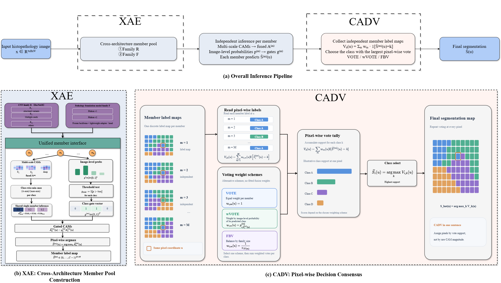
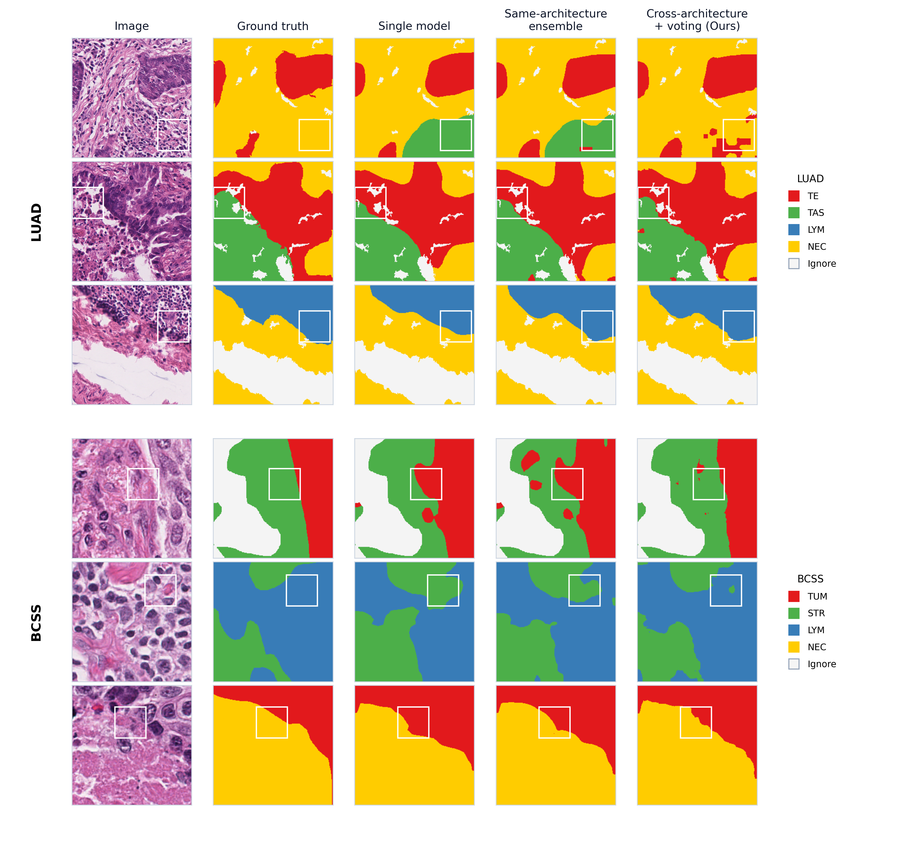

# XAE-CADV

**XAE-CADV: Cross-Architecture Ensemble and Decision Voting for Weakly Supervised Histopathology Image Segmentation**

跨架构集成与决策投票的单阶段弱监督病理图像分割 —— 论文官方复现代码（IEEE JBHI）。｜ [English](README_EN.md)

## 方法概览

XAE-CADV 是一个**推理阶段**的聚合框架：不改变任何成员模型的训练目标、网络结构与前向计算，用两个即插即用组件提升像素级预测。

| 组件 | 作用 | 说明 |
|---|---|---|
| **Module I · XAE**<br>Cross-Architecture Ensemble（式 1） | 构造**跨架构成员池** | $\mathcal{M}=\mathcal{M}_R\cup\mathcal{M}_F$：族 $\mathcal{M}_R$ 为 ResNet38 CNN 成员；族 $\mathcal{M}_F$ 为 Phikon v1 / Phikon-v2 病理基础模型成员（冻结骨干 + 轻量适配器）。所有成员仅用**图像级标签**训练/适配。 |
| **Module II · CADV**<br>Cross-Architecture Decision Voting（式 7–14） | **像素级决策投票** | 每个成员先独立产生离散像素预测（式 6），再按类累计投票（式 7）并取 argmax（式 8）。三种零超参规则：**VOTE**（式 9–10）、**wVOTE**（式 11–12）、**FBV**（式 13–14）。CADV 不引入额外训练，也不需要成员预测之外的前向计算。 |



**单成员共享推理管线**（式 2–6）：3 路 TTA（原图 / 水平翻转 / 垂直翻转）→ CAM 对齐到原坐标并逆变换后**先跨 TTA 平均**，再逐类 min–max 归一化 → 多尺度融合 `0.6/0.2/0.2` → 图像级硬阈值门控（含全零回退；BCSS 逐类 `[0.8,0.9,0.8,0.6]`、LUAD 统一 `0.2`）→ 在激活类内 argmax。

PFM 成员不使用原始 transformer attention 图：ViT 的 14×14 patch token（v1 取第 {3,6,9,12} 层、v2 取第 {6,12,18,24} 层，约 25/50/75/100% 深度）经可学习适配器（1×1 投影 → 2× 转置卷积 → BN → ReLU）升到 28×28，再接与 CNN 成员同构的 1×1 CAM 头；第 1 个分支为辅助分支，其余 3 个分支参与多尺度融合。全冻结配置约 **5.25 M** 可训练参数。

## 主要结果（test mIoU, %）

| 配置（同一套成员池内比较） | BCSS-WSSS | LUAD-HistoSeg |
|---|---|---|
| Same-architecture pool + VOTE | 70.76 | 77.90 |
| **Cross-architecture pool（XAE）+ CADV（VOTE）** | **72.37** | **78.57** |

跨架构池上的投票规则对照（BCSS / LUAD）：wVOTE 72.40 / 78.41，FBV 72.31 / 77.24。



> 定性图为 BCSS-WSSS 测试 patch 的可视化颜色（TUM 红 / STR 绿 / LYM 蓝 / NEC 黄），浅灰背景为忽略像素（不参与指标）；其上标注的像素准确率仅为单 patch 描述符，论文指标为全测试集累积混淆矩阵口径。

## 运行环境（论文实验）

- 单卡 **NVIDIA L20（48 GB）**；PyTorch（NGC 容器）
- `transformers 4.40.2`、`timm 1.0.30`；Python 3.10

```bash
conda create -n xaecadv python=3.10 -y
conda activate xaecadv
pip install -r requirements.txt
pip install mxnet==1.9.1          # 仅用于将 ImageNet 初始化 .params 权重转为 torch（一次即可）
```

## 数据与权重下载（外部链接）

| 文件 | 放置位置 | 下载 |
|---|---|---|
| ImageNet 初始化权重 `ilsvrc-cls_rna-a1_cls1000_ep-0001.params` | `init_weights/` | [Google Drive](https://drive.google.com/file/d/1Rka2SzqAwxUEFb28tbmiy2anhkkFOnTg/view?usp=drive_link) |
| BCSS-WSSS 数据集 | `datasets/BCSS-WSSS/` | [Google Drive](https://drive.google.com/file/d/178eSM9xs5jITt5P2kjaswDlJzwlU5gps/view?usp=drive_link) |
| LUAD-HistoSeg 数据集 | `datasets/LUAD-HistoSeg/` | [Google Drive](https://drive.google.com/file/d/1lWAeCp6UN30VRVmqv97kA2sJ1Pp2frhC/view?usp=drive_link) |
| Phikon v1（ViT-B/16） | Hugging Face 缓存（自动） | [huggingface.co/owkin/phikon](https://huggingface.co/owkin/phikon) |
| Phikon-v2（DINOv2 ViT-L/24） | Hugging Face 缓存（自动） | [huggingface.co/owkin/phikon-v2](https://huggingface.co/owkin/phikon-v2) |

数据集目录结构（官方发行版原样放置即可；训练集图像级标签在文件名中，val/test 含 `img/` 与 `mask/`）：

```text
datasets/
├── BCSS-WSSS/{training, val/{img,mask}, test/{img,mask}}/
└── LUAD-HistoSeg/{training, val/{img,mask}, test/{img,mask}}/
```

> Phikon 权重默认以**离线模式**加载（`network/phikon_cam.py` 设 `HF_HUB_OFFLINE=1`）。首次使用请任选其一：
> 1) 预热缓存：`HF_HUB_OFFLINE=0 python -c "from transformers import AutoModel; AutoModel.from_pretrained('owkin/phikon')"`（v2 同理）；
> 2) 运行时覆盖：`export HF_HUB_OFFLINE=0 TRANSFORMERS_OFFLINE=0`（国内可同时 `export HF_ENDPOINT=https://hf-mirror.com`）。

## 目录结构

```text
XAE-CADV/
├── train_member.py          # 成员训练 / 单成员评估主脚本（--network 切换 ResNet38 / Phikon）
├── run_member.sh            # 训练与评估快捷脚本
├── run_ablation.sh          # HFRM 结构消融一键脚本（BL / GSR / CH15 / K7 / K15 / K21）
├── network/
│   ├── resnet38_cls.py      # 族 R 成员：ResNet38 + HFRM + 多尺度 CAM 分支
│   ├── resnet38d.py         # ResNet38 定义 + mxnet→torch 权重转换
│   ├── phikon_cam.py        # 族 F 成员：Phikon v1/v2 冻结骨干 + 适配器 + CAM 头
│   └── timm_cam.py          # 可选：timm 骨干适配（扩展用）
├── tool/                    # 数据集 / 推理 / 评估 / 优化器等基础工具
│   ├── GenDataset.py        # 训练集与推理集（含官方样本顺序）
│   ├── infer_fun.py         # 推理管线（TTA + 多尺度融合 + 门控）
│   ├── iouutils.py          # IoU / mIoU 官方口径
│   └── ...
├── research/                # 复现与分析脚本
│   ├── cacg_collect.py      # 采集成员缓存（融合 CAM + 图像级概率）→ /tmp/ens
│   ├── cacg.py              # 池级聚合评估：打分平均 / VOTE / wVOTE / FBV
│   ├── verify_repro.py      # 一键复现校验（与论文期望值 ±0.02 比对）
│   ├── softgate_sweep.py    # 单成员 TTA 推理与门控扫描（可导出缓存 npz）
│   ├── ens_greedy_val.py    # val 上成员池选择/剔除
│   ├── gate_decomp.py       # 门控缺陷分解（只去假阳 / 只补假阴）
│   ├── gate_fp_stats.py     # 假阳实例可分性诊断（TP/FP 特征 AUC）
│   ├── make_figs.py         # 补充图 + 族级 FP/TP 保留率统计（_delta_of）
│   ├── make_luad_maps.py    # LUAD 预测缓存（定性图用）
│   ├── make_fig3_grid.py    # 定性结果网格图
│   └── phikon_tune.py       # Phikon 推理超参诊断
├── core_method/core.py      # 核心方法精简实现（对应论文公式）
├── assets/                  # README / 论文用图与绘图脚本
└── results/ablation_results.csv   # HFRM 消融汇总（本仓库实测）
```

## 快速开始（最小复现：训练成员 → 采集缓存 → 投票评估）

```bash
# 1) 训练成员：ResNet38（族 R，ImageNet 初始化，端到端）
bash run_member.sh bcss-train

# 2) 训练 PFM 成员（族 F，冻结骨干 + 适配器；--weights "" 跳过 ImageNet 加载）
PHIKON_ID=owkin/phikon    python train_member.py --network network.phikon_cam \
  --dataset bcss --seed 42 --lr 0.001 --weights "" \
  --trainroot datasets/BCSS-WSSS/training --save_folder checkpoints_phikon/bcss_seed42 \
  --n_class 4 --img_size 224 --num_workers 8 --amp-dtype bf16 --max_epoches 25
PHIKON_ID=owkin/phikon-v2 python train_member.py --network network.phikon_cam \
  --dataset bcss --seed 42 --lr 0.01  --weights "" \
  --trainroot datasets/BCSS-WSSS/training --save_folder checkpoints_p2fm/bcss_pv2 \
  --n_class 4 --img_size 224 --num_workers 8 --amp-dtype bf16 --max_epoches 25

# 3) 采集成员缓存（融合 CAM + 图像级概率 → /tmp/ens）
python research/cacg_collect.py --dataset bcss --family r38 --tags k15_s42
PHIKON_ID=owkin/phikon    python research/cacg_collect.py --dataset bcss --family pv1 --tags pv1_seed42
PHIKON_ID=owkin/phikon-v2 python research/cacg_collect.py --dataset bcss --family pv2 --tags pv2

# 4) 池级聚合评估（VOTE / wVOTE / 打分平均）
python research/cacg.py --dataset bcss --tags k15_s42,pv1_seed42,pv2
```

完整复现（23 / 6 成员池、全部消融、图表）见 **[REPRO.md](REPRO.md)**。

## 复现校验

`research/verify_repro.py` 会把关键成员池的打分平均、VOTE、wVOTE 与论文期望值逐一比对（容差 ±0.02）：

```bash
python research/verify_repro.py
```

| 数据集 / 池 | 打分平均(mean) | VOTE | wVOTE |
|---|---|---|---|
| BCSS · 23 成员 | 71.99 | **72.37** | 72.40 |
| BCSS · 同架构 R11 | 70.72 | 70.76 | — |
| LUAD · 4×R38 变体 + 2 PFM（跨架构 6 成员） | 79.04 | **78.57** | 78.41 |
| LUAD · 4×R38 变体 | 78.13 | 77.90 | — |
| LUAD · R11（同架构） | 77.83 | 77.54 | — |

## 已知限制与说明（与论文一致）

- **LUAD-HistoSeg 划分**：官方为 patch 级划分，val 与 test 共享 14 张 WSI（val 192/300、test 181/307 个 patch 位于共享滑片）；该重叠来自官方发行划分，应作为"发布协议下的性能"，而非独立滑片泛化。
- **LUAD test 属探索性**：8 / 15 成员池变体曾在名义 test 上检视，因此 LUAD test 结果不是完全未触碰的估计，需在新 WSI 不相交的留出集上确认。
- **预训练来源重叠**：BCSS-WSSS 派生自 TCGA-BRCA，与 Phikon 系列的 TCGA 来源预训练语料存在来源级潜在重叠（自监督预训练，无像素标签泄漏；逐图清单不可得，无法精确核对）。

## 引用

```bibtex
@article{zhang2026xaecadv,
  title   = {{XAE-CADV}: Cross-Architecture Ensemble and Decision Voting for
             Weakly Supervised Histopathology Image Segmentation},
  author  = {Zhang, Xu and Lu, Xianzheng and Liu, Yang and Wei, Chongqi and
             Wang, Yanling and Sun, Liangchao and Meng, Xue},
  journal = {IEEE Journal of Biomedical and Health Informatics},
  year    = {2026},
  note    = {Under review}
}
```

## 致谢

- 病理基础模型权重：[Phikon](https://huggingface.co/owkin/phikon) / [Phikon-v2](https://huggingface.co/owkin/phikon-v2)（Owkin）
- 数据集：BCSS-WSSS（源自 BCSS，Amgad et al., *Bioinformatics* 2019）、LUAD-HistoSeg

本仓库代码仅供学术研究使用；第三方数据集与预训练权重遵循其各自许可。
